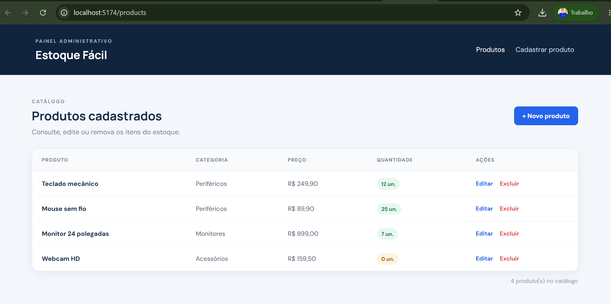
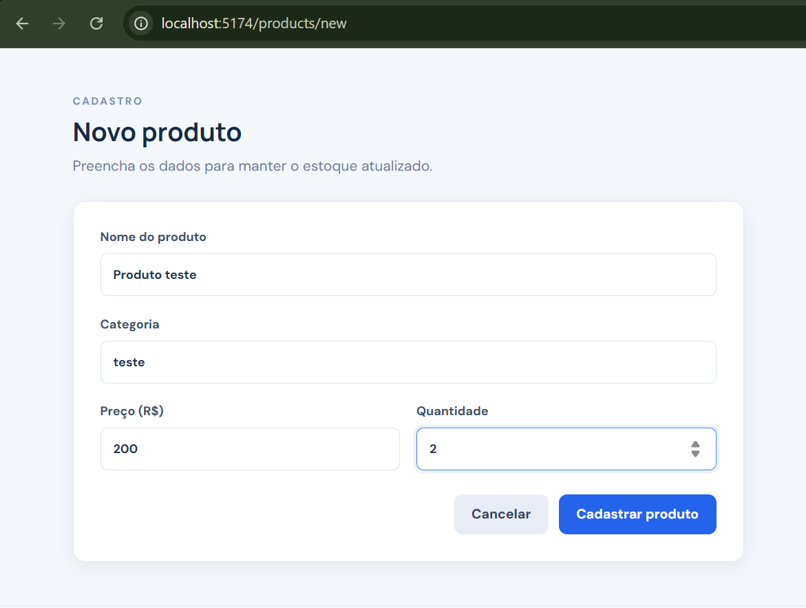
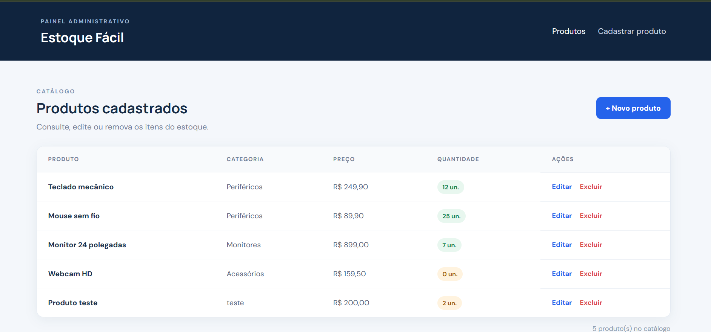
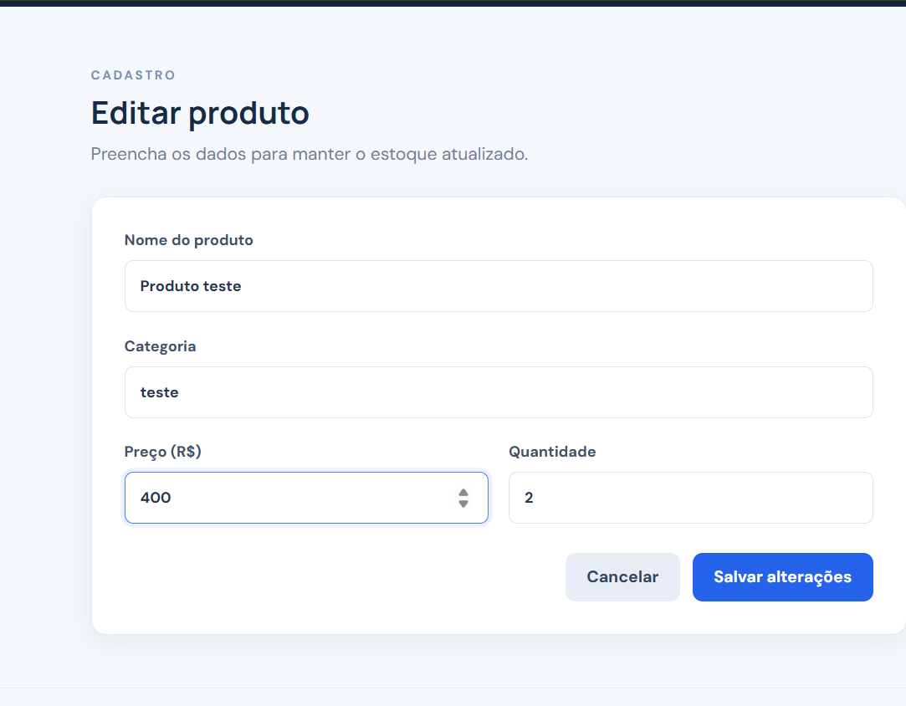
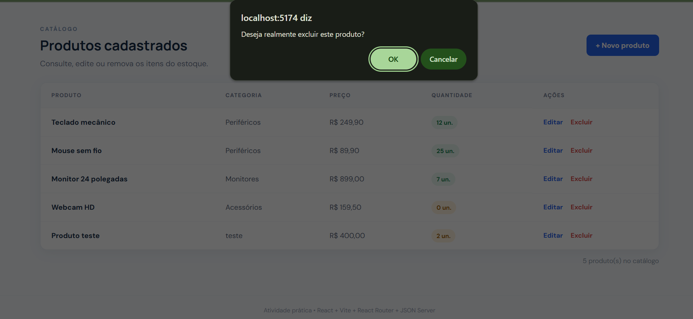
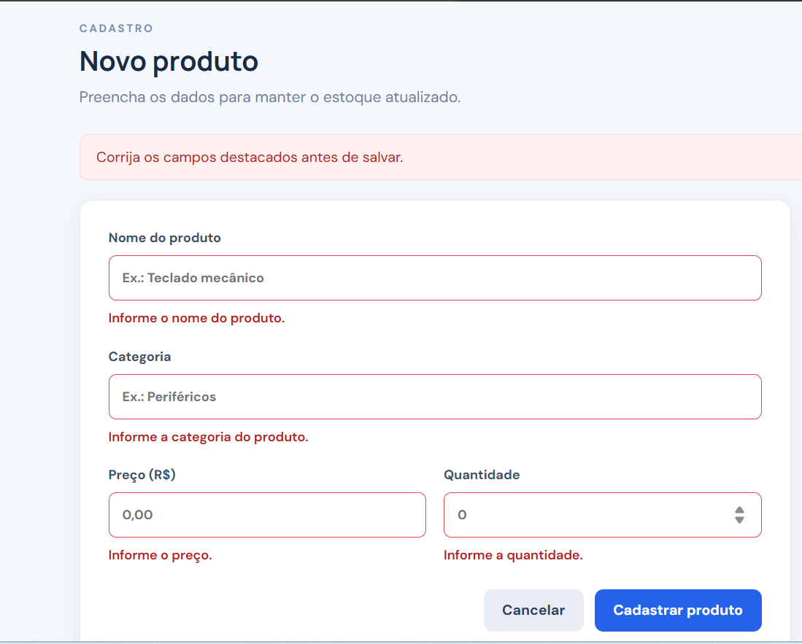
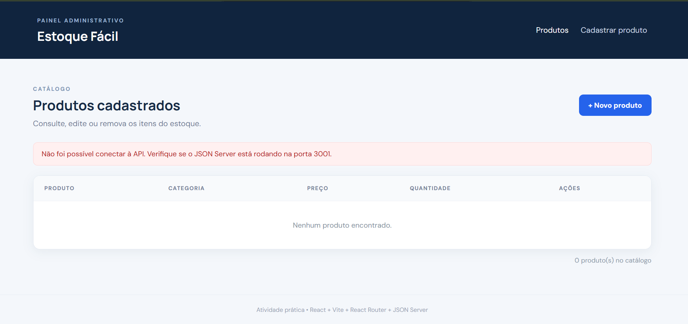
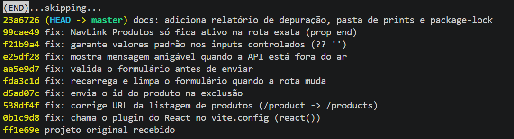

# Relatório de Depuração

**Laboratório de Debug – Estoque Fácil**
Aluna: **Iris Geovanna de Almeida Silva**
Curso: **Técnico em Análise e Desenvolvimento de Sistemas – SENAI**

Stack: React 18 + Vite 5 + React Router DOM 6 + JSON Server 0.17

---

## 1. Como a investigação foi feita

1. Instalei as dependências (`npm install`), subi a API (`npm run server`, porta 3001) e o front (`npm run dev`, porta 5173).
2. Testei os métodos HTTP direto na API com **curl**, para saber como o JSON Server responde antes de olhar o front.
3. Comparei as URLs chamadas em `src/services/productService.js` com as rotas reais da API.
4. Revisei `vite.config.js`, `App.jsx`, `productService.js`, `ProductList.jsx` e `ProductForm.jsx`.
5. Reproduzi cada sintoma no app rodando, observando **console** (erros e avisos do React), **requisições** (método, URL e status, como na aba Network), o **terminal do JSON Server** (que registra cada requisição com o status) e o **db.json**. Para repetir as sequências de navegação sempre do mesmo jeito, antes e depois de cada correção, também rodei o código do app num navegador simulado (jsdom) com um script que registra o console e cada requisição à API. Os resultados batem com o que aparece no console e na aba Network do navegador (ver prints na seção 5).
6. Fiz uma correção por vez, com um commit cada, e repeti o mesmo teste para confirmar.

O histórico do git (`git log --oneline`) mostra o projeto original e um commit por correção.

---

## 2. Resumo das falhas encontradas

| Nº | Arquivo | Problema |
|---|---|---|
| 1 | `vite.config.js` | Plugin do React passado sem ser chamado (`react` em vez de `react()`); tela em branco |
| 2 | `src/services/productService.js` | Listagem chamava `/product` (404) em vez de `/products` |
| 3 | `src/pages/ProductList.jsx` | `deleteProduct()` chamado sem o `id`: `DELETE /products/undefined` (404) |
| 4 | `src/pages/ProductForm.jsx` | `useEffect` com `[]`: formulário reaproveitado mantinha dados antigos e não recarregava ao trocar de produto |
| 5 | `src/pages/ProductForm.jsx` | Sem validação: produto vazio era gravado (`Number('')` vira `0`) |
| 6 | `src/services/productService.js` | Com a API desligada, a tela mostrava "Failed to fetch" |
| 7 | `src/pages/ProductForm.jsx` | Campo `undefined` vindo da API deixava o input "não controlado" (aviso do React) |
| 8 | `src/App.jsx` | NavLink "Produtos" ficava ativo também em `/products/new` |

Também conferi, sem precisar alterar:
- **Confirmação de exclusão (regra 7)**: o `window.confirm` já existia e funciona. Ao cancelar, nenhuma requisição é enviada.
- **"A tela remove o item mesmo sem excluir na API?"**: **não**. O serviço lança erro quando `!response.ok`, então o `filter` que remove a linha só roda depois de um DELETE bem-sucedido. Com a falha 3, a tela mostrava "Não foi possível excluir o produto." e mantinha o item.
- **PUT com `id` em texto**: o front envia `id: "1"` (vindo de `useParams`) no corpo, mas o JSON Server 0.17 mantém o id numérico original (testado com curl), então não há dano.
- **F5 nas rotas**: o Vite (dev e preview) já devolve o `index.html` para qualquer rota (fallback de SPA).

---

## 3. Detalhamento das falhas

### Falha 1 – Plugin do React não executado

| Campo | Descrição |
|---|---|
| **Arquivo/local** | `vite.config.js`, linha 5 |
| **Sintoma** | Tela em branco: o código gerado usa `React.createElement` sem importar o `React`, o que causa `ReferenceError: React is not defined` no console. O `npm run build` passava "com sucesso", mas gerava um bundle com o mesmo problema. |
| **Causa** | `plugins: [react]` passa a **função** do plugin sem chamá-la. O Vite não recebe o plugin real e o esbuild compila o JSX no modo clássico (`React.createElement(...)`). Como os componentes não fazem `import React`, a variável `React` não existe em tempo de execução. |
| **Diagnóstico** | Terminal: `curl http://localhost:5173/src/App.jsx` mostrou o código transformado com `React.createElement(...)` e nenhum `import React`. Também rodei `vite build` e encontrei `React.createElement` no bundle final. |
| **Correção** | Chamar a função do plugin (ver código abaixo). |
| **Validação** | Depois da correção, o `curl` em `/src/App.jsx` mostra `jsxDEV` + `RefreshRuntime` (JSX automático + Fast Refresh), o `index.html` passa a incluir o preâmbulo do `react-refresh`, a tela renderiza e o bundle de produção tem 0 ocorrências de `React.createElement`. |

```js
// antes
plugins: [react],
// depois
plugins: [react()],
```

### Falha 2 – URL errada na listagem

| Campo | Descrição |
|---|---|
| **Arquivo/local** | `src/services/productService.js`, função `getProducts` |
| **Sintoma** | A listagem mostrava "Não foi possível carregar os produtos." e "Nenhum produto encontrado." |
| **Causa** | O fetch apontava para `/product` (singular). O JSON Server só cria rotas para as chaves do `db.json`, e a chave é `products`. |
| **Diagnóstico** | Network: `GET http://localhost:3001/product` → **404**. Curl: `curl http://localhost:3001/product` → `{}` HTTP 404, e `curl http://localhost:3001/products` → HTTP 200 com os 4 produtos. |
| **Correção** | Corrigir a rota (ver código abaixo). |
| **Validação** | `GET /products 200` e a tabela exibe os 4 produtos (Teclado mecânico, Mouse sem fio, Monitor 24 polegadas, Webcam HD). |

```js
// antes
const response = await fetch(`${API_URL}/product`)
// depois
const response = await fetch(`${API_URL}/products`)
```

### Falha 3 – Exclusão sem o id

| Campo | Descrição |
|---|---|
| **Arquivo/local** | `src/pages/ProductList.jsx`, função `handleDelete` |
| **Sintoma** | Depois de confirmar a exclusão, aparecia "Não foi possível excluir o produto." e o item continuava na lista e no `db.json`. |
| **Causa** | `handleDelete(id)` recebia o id, mas chamava `deleteProduct()` **sem argumento**. Dentro do serviço, `id` ficava `undefined` e a URL virava `/products/undefined`. |
| **Diagnóstico** | Network: `DELETE http://localhost:3001/products/undefined` → **404**. Curl: `curl -X DELETE http://localhost:3001/products/undefined` → HTTP 404. Comparando a assinatura `deleteProduct(id)` com a chamada, vi que o argumento faltava. |
| **Correção** | Passar o id recebido (ver código abaixo). |
| **Validação** | Cadastrei "Headset USB" (id 5) e excluí pela tela: `DELETE /products/5 200`, a linha some e `curl /products/5` → 404. Ao **cancelar** a confirmação, nenhuma requisição é feita (regra 7). |

```js
// antes
await deleteProduct()
// depois
await deleteProduct(id)
```

### Falha 4 – Formulário reaproveitado (useEffect com `[]`)

| Campo | Descrição |
|---|---|
| **Arquivo/local** | `src/pages/ProductForm.jsx`, `useEffect` de carregamento |
| **Sintoma** | 1) Em "Editar" do Teclado mecânico, ao clicar em **"Cadastrar produto"** no menu, o título mudava para "Novo produto", mas os campos **continuavam preenchidos** com o Teclado. 2) Trocar de `/products/1/edit` para `/products/2/edit` não buscava o produto 2: o formulário seguia com o produto 1 e nenhum GET era feito. 3) O estado `loading` nunca era reiniciado. Nenhum erro aparecia no console. |
| **Causa** | As rotas `/products/new` e `/products/:id/edit` renderizam o **mesmo componente na mesma posição**, então o React reaproveita a instância e o estado (`form`, `loading`, `error`) permanece. Com dependências `[]`, o efeito só roda na montagem e ignora as mudanças de `id`. |
| **Diagnóstico** | Reproduzi a sequência de navegação e observei os valores dos inputs e as requisições: na troca 1 → 2 → 999 não saiu nenhum `GET /products/:id`, e todos os passos mostraram `name="Teclado mecânico"`. Isso indicou que o efeito não rodava de novo. |
| **Correção** | Dependências `[id, isEditing]`; em toda troca de rota, limpar formulário/erro e reiniciar o `loading`; flag `ignore` para descartar a resposta atrasada de um produto anterior (ver código abaixo). |
| **Validação** | Mesma sequência depois da correção: Editar 1 → menu "Cadastrar" mostra os campos **vazios**; voltar para o 1 refaz `GET /products/1`; trocar para o 2 faz `GET /products/2` e mostra "Mouse sem fio"; o 999 faz `GET /products/999 404` e mostra "Produto não encontrado." com o formulário limpo. |

```jsx
// antes
useEffect(() => {
  if (!isEditing) return
  async function loadProduct() { /* ... */ setLoading(false) }
  loadProduct()
}, [])

// depois
useEffect(() => {
  setError('')
  setFieldErrors({})
  setForm(initialForm)

  if (!isEditing) {
    setLoading(false)
    return
  }

  let ignore = false // descarta respostas de um produto anterior
  setLoading(true)

  async function loadProduct() {
    try {
      const product = await getProductById(id)
      if (ignore) return
      setForm({ /* ... */ })
    } catch (err) {
      if (!ignore) setError(err.message || 'Erro ao buscar produto.')
    } finally {
      if (!ignore) setLoading(false)
    }
  }

  loadProduct()
  return () => { ignore = true }
}, [id, isEditing])
```

### Falha 5 – Ausência de validação

| Campo | Descrição |
|---|---|
| **Arquivo/local** | `src/pages/ProductForm.jsx`, função `handleSubmit` |
| **Sintoma** | Enviar o formulário com nome só de espaços e os outros campos vazios **gravava um produto** `{ "name": "   ", "category": "", "price": 0, "quantity": 0 }`. |
| **Causa** | O `handleSubmit` enviava os dados direto. `Number('')` vira `0`, então preço e quantidade vazios passavam como zero. Não havia checagem das regras 2 e 3 do README. |
| **Diagnóstico** | Network: `POST /products` → **201** com o formulário vazio. Conferi o registro criado com `curl http://localhost:3001/products/5` (e depois o apaguei). |
| **Correção** | Função `validate()` com as regras do README; mensagens por campo (`.field-error`) e borda vermelha; aviso geral "Corrija os campos destacados antes de salvar."; `return` antes do fetch; `noValidate` no form para mostrar sempre as nossas mensagens em vez da validação nativa do navegador; `trim()` no nome e na categoria. Decidi também exigir quantidade inteira (o input já tem `step="1"`). |
| **Validação** | Vazio → "Informe o nome do produto.", "Informe a categoria do produto.", "Informe o preço.", "Informe a quantidade."; preço `-5` → "O preço não pode ser negativo."; quantidade `2.5` → "A quantidade deve ser um número inteiro."; quantidade `-1` → "A quantidade não pode ser negativa.". Em todos os casos **nenhuma requisição** foi enviada e o `db.json` continuou com 4 produtos. |

```jsx
// antes
const product = { ...form, price: Number(form.price), quantity: Number(form.quantity) }

// depois
function validate(form) {
  const errors = {}
  if (!String(form.name).trim()) errors.name = 'Informe o nome do produto.'
  if (!String(form.category).trim()) errors.category = 'Informe a categoria do produto.'

  const price = String(form.price).trim()
  if (price === '') errors.price = 'Informe o preço.'
  else if (!Number.isFinite(Number(price))) errors.price = 'O preço deve ser um número.'
  else if (Number(price) < 0) errors.price = 'O preço não pode ser negativo.'
  // quantidade: mesmas regras + Number.isInteger
  return errors
}

// no handleSubmit
const errors = validate(form)
setFieldErrors(errors)
if (Object.keys(errors).length > 0) {
  setError('Corrija os campos destacados antes de salvar.')
  return // não envia a requisição com dados inválidos
}
const product = {
  name: form.name.trim(),
  category: form.category.trim(),
  price: Number(form.price),
  quantity: Number(form.quantity),
}
```

### Falha 6 – Mensagem "Failed to fetch" com a API desligada

| Campo | Descrição |
|---|---|
| **Arquivo/local** | `src/services/productService.js` (todas as funções) |
| **Sintoma** | Com o JSON Server parado, a listagem, a edição e o cadastro mostravam apenas **"Failed to fetch"**, que não diz nada ao usuário (regra 6). |
| **Causa** | Quando o servidor não responde, o `fetch` não retorna uma resposta com status: ele **lança** `TypeError: Failed to fetch`. O `if (!response.ok)` nem chega a rodar, e o `err.message` técnico ia direto para a tela. |
| **Diagnóstico** | Parei o JSON Server. Terminal: `curl http://localhost:3001/products` → código `000` (conexão recusada). Network: requisições com falha `net::ERR_CONNECTION_REFUSED`. A mensagem exibida era o texto do erro do navegador. |
| **Correção** | Função `apiFetch` no serviço que captura o erro de rede e lança uma mensagem clara; todas as funções passaram a usá-la (ver código abaixo). |
| **Validação** | Com a API parada, as três telas mostram: "Não foi possível conectar à API. Verifique se o JSON Server está rodando na porta 3001." Com a API ligada de novo, tudo volta a funcionar. |

```js
// antes
const response = await fetch(`${API_URL}/products`)

// depois
const CONNECTION_ERROR =
  'Não foi possível conectar à API. Verifique se o JSON Server está rodando na porta 3001.'

async function apiFetch(url, options) {
  try {
    return await fetch(url, options)
  } catch {
    throw new Error(CONNECTION_ERROR)
  }
}

const response = await apiFetch(`${API_URL}/products`)
```

### Falha 7 – Input passando de não controlado para controlado

| Campo | Descrição |
|---|---|
| **Arquivo/local** | `src/pages/ProductForm.jsx`, `setForm` dentro de `loadProduct` |
| **Sintoma** | Se o produto vier da API sem algum campo (ex.: registro antigo sem `category`), o console mostra: `Warning: A component is changing an uncontrolled input to be controlled.` |
| **Causa** | `value={undefined}` faz o React tratar o input como **não controlado**. Quando o usuário digita, o valor vira texto e o input passa a ser controlado, o que o React avisa. |
| **Diagnóstico** | Simulei a resposta de `GET /products/1` como `{ "id": 1, "name": "Produto incompleto" }` e digitei no campo Categoria: o aviso apareceu no console (é um aviso, não um erro fatal). |
| **Correção** | Valor padrão com `?? ''` (ver código abaixo). |
| **Validação** | Mesma simulação: os campos ausentes aparecem vazios e o aviso não aparece mais ao digitar. |

```jsx
// antes
setForm({ name: product.name, category: product.category, price: product.price, quantity: product.quantity })

// depois
setForm({
  name: product.name ?? '',
  category: product.category ?? '',
  price: product.price ?? '',
  quantity: product.quantity ?? '',
})
```

### Falha 8 – Dois links ativos no menu

| Campo | Descrição |
|---|---|
| **Arquivo/local** | `src/App.jsx`, `<nav>` |
| **Sintoma** | Em `/products/new`, os links "Produtos" **e** "Cadastrar produto" apareciam destacados ao mesmo tempo. |
| **Causa** | Por padrão, o `NavLink` do React Router 6 fica ativo também nas **sub-rotas**: `/products` casa com `/products/new` e com `/products/1/edit`. |
| **Diagnóstico** | Inspecionei os elementos do menu: os dois `<a>` estavam com a classe `active` em `/products/new`. |
| **Correção** | Prop `end` no link da listagem (ver código abaixo). |
| **Validação** | `/products` → só "Produtos" ativo; `/products/new` → só "Cadastrar produto" ativo; `/products/1/edit` → nenhum dos dois (nenhum link do menu corresponde à edição). |

```jsx
// antes
<NavLink to="/products">Produtos</NavLink>
// depois
<NavLink to="/products" end>Produtos</NavLink>
```

---

## 4. Critérios de aceite

- [x] **Listagem carrega os produtos da API.** `GET /products 200`, 4 linhas na tabela.
- [x] **Cadastro persiste um novo produto no `db.json`.** Cadastrei "Headset USB / Audio / 199,90 / 8": `POST /products 201`, o produto aparece na lista e no `db.json` com `id: 5`.
- [x] **Edição persiste as alterações do produto correto.** Editei o produto 2 (preço 89,90 → 79,90; quantidade 25 → 30): `PUT /products/2 200`. No `db.json`, só o id 2 mudou e os outros ficaram iguais.
- [x] **Exclusão remove o produto correto.** Excluí "Headset USB" com confirmação: `DELETE /products/5 200`, e `GET /products/5` → 404. Os outros 4 continuaram.
- [x] **Formulário apresenta dados ao editar.** `/products/2/edit` abre com "Mouse sem fio / Periféricos / 89.9 / 25". A troca entre produtos e para o cadastro também atualiza o formulário.
- [x] **Validações impedem dados inválidos.** Vazio, só espaços, negativo e quantidade fracionada são bloqueados com mensagem e sem requisição.
- [x] **Rotas funcionam ao atualizar o navegador.** `/products`, `/products/new` e `/products/1/edit` respondem 200 com o `index.html` no `npm run dev` e no `vite preview`, e cada rota renderiza a tela certa ao carregar direto.
- [x] **Relatório explica causa, correção e teste de cada falha.** Seção 3.

Extra: `npm run build` compila sem erros. Ao final, o `db.json` foi restaurado para os 4 produtos originais.

---

## 5. Evidências

### 5.1 Testes da API com curl (saídas reais)

```text
$ curl http://localhost:3001/products
[ ...4 produtos... ]
HTTP 200

$ curl http://localhost:3001/products/1
{
  "id": 1,
  "name": "Teclado mecânico",
  "category": "Periféricos",
  "price": 249.9,
  "quantity": 12
}
HTTP 200

$ curl -X POST -H "Content-Type: application/json" --data-binary @post.json http://localhost:3001/products
{
  "name": "Headset USB",
  "category": "Audio",
  "price": 199.9,
  "quantity": 8,
  "id": 5
}
HTTP 201

$ curl -X PUT -H "Content-Type: application/json" --data-binary @put.json http://localhost:3001/products/5
{
  "name": "Headset USB Pro",
  "category": "Audio",
  "price": 249.9,
  "quantity": 5,
  "id": 5
}
HTTP 200

$ curl -X DELETE http://localhost:3001/products/5
{}
HTTP 200

$ curl http://localhost:3001/products/5
{}
HTTP 404
```

Rotas que o front original chamava de forma errada:

```text
$ curl http://localhost:3001/product
{}
HTTP 404

$ curl -X DELETE http://localhost:3001/products/undefined
{}
HTTP 404
```

API desligada:

```text
$ curl -w "%{http_code}" http://localhost:3001/products
000        (conexão recusada)
```

Requisições registradas no terminal do JSON Server durante os testes pelo front:

```text
GET /products 200
POST /products 201
PUT /products/2 200
DELETE /products/5 200
```

### 5.2 Prints do sistema



















---

## 6. Reflexão

O erro mais difícil de encontrar foi o do `useEffect` com dependências `[]` no formulário reaproveitado. Os outros deixavam rastro: a tela branca gerava `React is not defined` no console, a listagem e a exclusão apareciam como 404 na aba Network e até o input não controlado gerava um aviso do React. Esse não gerava nada: nenhum erro, nenhum aviso, nenhuma requisição com status errado. Ele só aparecia numa sequência específica de navegação, abrindo "Editar" e depois clicando em "Cadastrar produto" pelo menu (ou trocando de um produto para outro sem voltar para a lista). Se eu testasse cada tela separadamente, entrando pela listagem ou dando F5, tudo parecia funcionar.

Para entender, precisei lembrar que o React reaproveita o mesmo componente quando duas rotas renderizam `<ProductForm />` na mesma posição, então o estado não é recriado. A pista que fechou o diagnóstico foi justamente a **ausência** de requisição: ao trocar de produto, nenhum `GET /products/:id` saía, ou seja, o efeito não estava rodando de novo. Aprendi que nem todo bug aparece como erro, e que também é importante testar os fluxos de navegação, e não só as telas isoladas.
